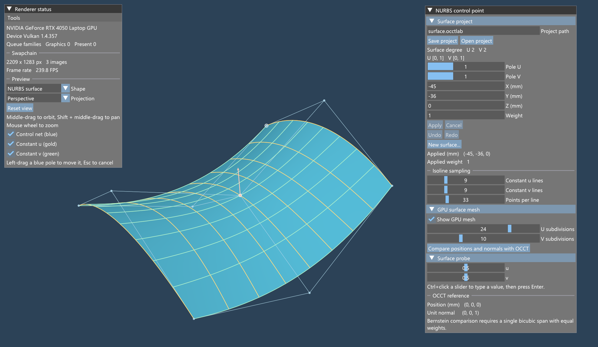

# Formlight Geometry

**Formlight Geometry** 是一个用 **C++23（命名模块）** 编写的交互式计算机辅助几何设计（CAGD）工作台，基于 **Open CASCADE Technology（OCCT）**、**Vulkan 1.3**、**Slang**、**SDL3** 与 **Dear ImGui**。

- **交互式 NURBS 曲线与曲面**：拖动控制点、调整权重、查看拟合残差、检查/插入节点、逐方向升阶，并支持单步撤销/重做与 `.occtlab` 项目读写。
- **CPU / GPU 求值对照**：用 Slang 计算着色器在 GPU 上实时生成 NURBS 曲面网格与法向，并与 OCCT 在相同参数点上逐点对比位置误差（mm）与法向夹角（度）。
- **B-Rep 实体与 STEP 往返**：构造方块、圆柱与带孔板，支持面拾取高亮、曲面类型与面积查询，以及 STEP 导出重读校验。



> 图中为 U、V 均为二次的鞍形曲面：浅蓝色折线为 `3×3` 控制网，青色网格由 GPU 计算着色器生成，金色和绿色曲线分别为固定 $u$ 与固定 $v$ 的等参线，中央箭头为当前探针位置的单位法向。

## 1. 快速上手：试一张曲面

1. 在左侧 **Shape** 选择 `NURBS surface`；展开右侧 **GPU surface mesh** 并勾选 `Show GPU mesh`。
2. 左键拖动蓝色控制点实时变形；视口导航采用中键旋转、`Shift + 中键` 平移、滚轮缩放。
3. 在 **Surface probe** 调整 $u$、$v$，读取坐标与单位法向（按住 `Ctrl` 单击滑块可输入精确数值，按 `Enter` 确认）。
4. 点击 **Compare positions and normals with OCCT**，查看 GPU 与 OCCT 在相同参数网格上的位置误差（mm）和法向夹角（度）。

## 2. 创建与编辑曲线、曲面

曲线由有序点列构造，曲面由按 U/V 排列的矩形点网构造；两者均可在 XYZ 表格中输入坐标，或在 XY 平面上依次点选。

| 创建方式 | 曲线 | 曲面 |
| --- | --- | --- |
| 直接由控制点定义形状 | `From control points` | `From control net` |
| 插值，严格经过每个数据点 | `Interpolate through points` | `Interpolate through point grid` |
| 按给定容差逼近数据点 | `Approximate points` | `Approximate point grid` |

曲面另支持从平面或双三次 Bézier 预设起步；曲线与曲面均支持编辑控制点 XYZ 与权重、单步撤销/重做，以及保存和重开 `.occtlab` 项目文件。

### 拟合误差可视化
- **曲线**：金色逼近曲线与紫色插值曲线共用同一组数据点。预览显示控制点数与最大残差，创建后可逐点查看弦长参数与残差。
- **曲面**：粉色圆环标出原始数据点，亮粉色大圆环标出最大偏差点，连线另一端为曲面对应参数位置。调整容差可实时对比控制网尺寸、最大偏差（mm）与该点的 U/V 编号。

### 节点检查、插入与升阶
自定义直线与控制点曲线可在 **Custom knots** 中配置节点值与重数；自定义曲面控制网可分别配置 U、V 方向的次数与节点。

- **查看节点**：曲线展开 **Knots and multiplicities**，曲面分别展开 **U / V knots and multiplicities**，查看节点值、重数与内部节点保证的连续阶数。
- **插入节点**：曲线可在指定参数处插入节点；曲面在 **Surface probe** 选好 $(u, v)$ 后，点击 `Insert U knot at u`（增一列控制点）或 `Insert V knot at v`（增一行控制点），曲面形状严格不变。
- **升阶**：曲线支持直接升阶；曲面通过 `Elevate U degree (+1)` / `Elevate V degree (+1)` 逐方向提高次数，同时保留几何形状与原始数据点网。

## 3. B-Rep 实体与 STEP 往返

- **实体建模与面拾取**：OCCT 构造方块、圆柱和带孔板，三角化后交给 Vulkan 绘制；点击任意面可高亮并查看曲面类型与面积。
- **带孔板与 STEP 校验**：支持“圆柱布尔切除通孔”与“带圆孔平面轮廓拉伸”两种建模方式；在 **Plate STEP** 面板导出并重读 STEP 文件后，自动核对实体有效性、体积（$\text{mm}^3$）与柱面孔壁面积（$\text{mm}^2$）。

## 4. 构建与运行

目标环境为 **Windows x64**，需准备 **CMake 4.5+**、**Ninja**、**LLVM `clang-cl`**、支持 `import std;` 的 **MSVC 标准库与 Windows SDK**、支持 **Vulkan 1.3** 的显卡驱动，以及独立克隆并完成 bootstrap 的 **vcpkg**。

在仓库根目录的 PowerShell 中执行（先将第一行改为本机 vcpkg 路径）：

```powershell
$env:VCPKG_ROOT = 'D:\vcpkg'
cmake --preset release
cmake --build --preset release
ctest --preset release
.\build-release\formlight-geometry.exe
```

本机路径与共享缓存建议写入被 `.gitignore` 忽略的 `CMakeUserPresets.json`（使用 `release-local` 预设），完整说明见[构建与工具链配置](docs/build.md)。

## 文档导航

| 文档 | 内容概览 |
| --- | --- |
| [构建与工具链配置](docs/build.md) | `CMakeUserPresets.json` 缓存收口、OCCT 工具包裁剪、C++23 模块与 Slang 编译、CTest 回归一览 |
| [架构与核心实现](docs/architecture.md) | 三层模块边界、GPU Slang NURBS 求值与数值稳定性、B-Rep 三角化及 STEP 往返校验 |

---

界面中英文共用随程序分发的 **Noto Sans SC Regular 2.004**（约 7.95 MiB，构建时由 CMake 自动复制到可执行文件旁的 `fonts/` 目录）。[字体来源](https://github.com/notofonts/noto-cjk/blob/Sans2.004/Sans/SubsetOTF/SC/NotoSansSC-Regular.otf) · [字体许可证（SIL OFL 1.1）](assets/fonts/OFL.txt) · [项目 MIT 许可证](LICENSE)
